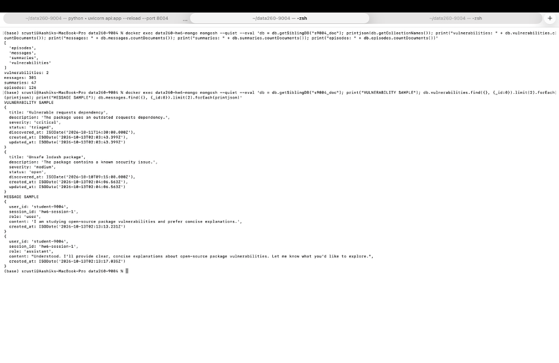
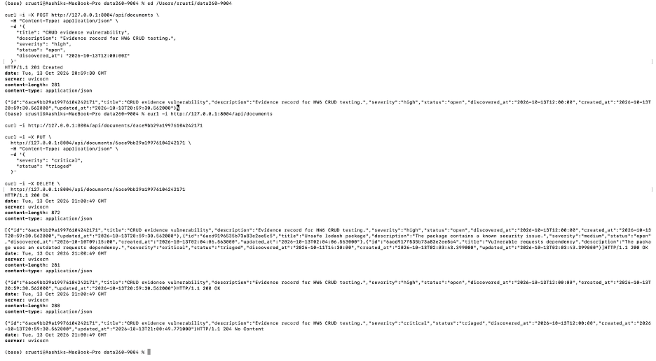
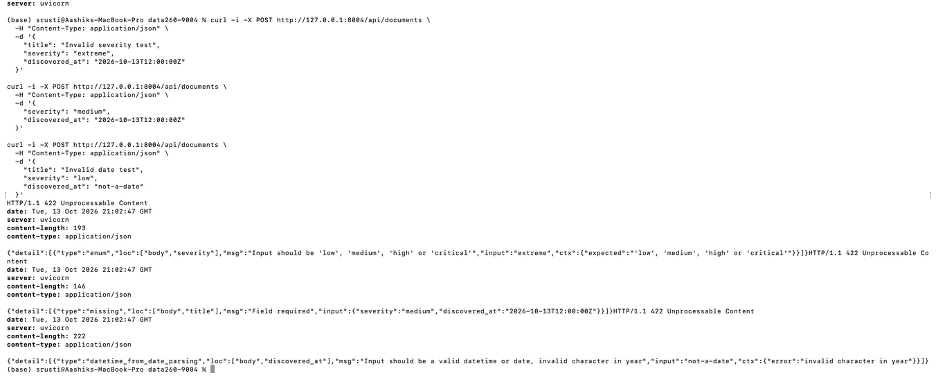
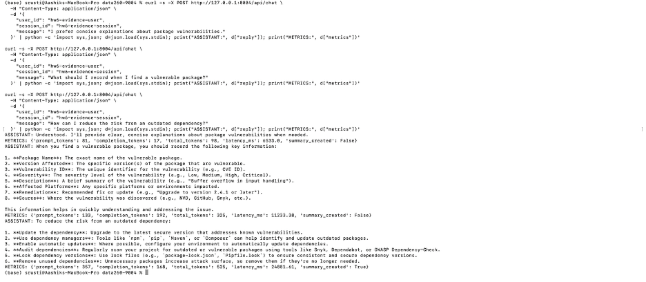
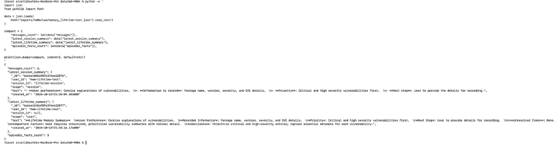
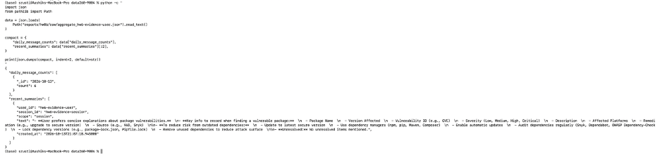
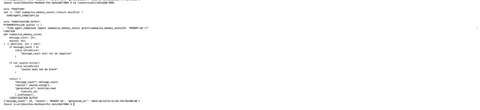

# DATA-260 Homework 6

Repository: https://github.com/shrustishetty-2401/data260-9004

## Section 0 - Configuration

- SID4: 9004
- PORT_BASE: 8004
- PREFIX: s9004
- SEED: 9004
- VERIFY_SEED: 269004
- DOMAIN_ID: 4
- Domain: open-source package vulnerabilities
- Hardware: Apple Silicon MacBook Pro
- Local model: Ollama qwen3:8b
- Final tagged commit: c9718e2293a264c0270df55a72edd0072056bc37

## Part 1 - MongoDB Document API

A MongoDB database named `s9004_doc` was created using MongoDB 7 and PyMongo.

The `vulnerabilities` collection includes:

- Required title with a maximum length of 100 characters.
- Optional description.
- Severity enum: low, medium, high, critical.
- Status enum: open, triaged, resolved.
- Required discovered_at date/time.
- Automatic created_at and updated_at timestamps.

Implemented endpoints:

- POST `/api/documents`
- GET `/api/documents`
- GET `/api/documents/{id}`
- PUT `/api/documents/{id}`
- DELETE `/api/documents/{id}`

Validation tests confirmed that invalid severity values, missing titles, and invalid date formats are rejected.

## Part 2 - Memory System

MongoDB collections:

- messages
- summaries
- episodes

The `/api/chat` endpoint:

- Saves user and assistant messages.
- Loads the short-term conversation window.
- Loads session summaries.
- Retrieves relevant episodic facts using cosine similarity.
- Calls the local Ollama qwen3:8b model.
- Records prompt tokens, completion tokens, total tokens, and latency.
- Creates session summaries every three user messages.

Additional endpoints:

- GET `/api/memory/{user_id}`
- GET `/api/aggregate/{user_id}`

A ten-message conversation was completed successfully. The memory response contained messages, a session summary, episodic facts, embeddings, and MongoDB IDs converted to JSON-safe strings.

## Part 3 - Memory Costs

| Setting | Mean prompt tokens/turn | Mean latency (ms) | Probe quality |
|---|---:|---:|---:|
| SHORT_TERM_N=4 | 286.97 | 5000.13 | 3.0 |
| SHORT_TERM_N=12 | 614.17 | 9255.64 | 2.8 |
| SHORT_TERM_N=30 | 1020.77 | 12746.58 | 2.8 |
| Eviction policy, N=12 | 685.40 | 10635.50 | 3.0 |

The eviction policy retains only the most recent ten episodic facts per user and removes older facts.

Estimated costs for 10,000 thirty-turn conversations:

| Setting | Mean completion tokens/turn | Estimated cost |
|---|---:|---:|
| SHORT_TERM_N=4 | 37.93 | $142.99 |
| SHORT_TERM_N=12 | 50.13 | $259.45 |
| SHORT_TERM_N=30 | 44.20 | $372.53 |
| Eviction policy, N=12 | 57.03 | $291.17 |

The best measured setting was SHORT_TERM_N=4 because it had the lowest prompt-token usage, latency, and estimated cost while maintaining a probe score of 3.0.

The worst measured setting was SHORT_TERM_N=30 because it had the highest prompt-token usage, latency, and estimated cost, with a probe score of 2.8.

The eviction policy did not reduce cost in this single run compared with baseline N=12. Its purpose was to demonstrate bounded episodic-memory growth.

## Part 4 - File-Based Memory

`AGENT.md` contains instructions covering:

- Project description.
- Technology stack.
- Coding conventions.
- Testing approach.
- Prohibited actions.

`MEMORY.md` was initially created with 55 lines, including duplicate and contradictory facts. The `/compact` command reduced it to 29 non-empty facts and recorded three contradictions for review.

Implemented commands:

- `/memory`
- `/compact`
- `/dream`
- `/help`

A type-hinted function using UTC timestamps was implemented and verified against the AGENT.md instructions.

## Verification

The HW6 smoke test passed:

- FastAPI health endpoint
- MongoDB document list
- MongoDB document creation
- MongoDB document deletion
- Memory endpoint
- Aggregate endpoint

## AI Use

See `AI_USE.md`.

## Raw Evidence

- `raw/chat_metrics.jsonl`
- `raw/experiment_short_term_4.json`
- `raw/experiment_short_term_12.json`
- `raw/experiment_short_term_30.json`
- `raw/experiment_eviction_12.json`
- `raw/memory_student-9004.json`
- `raw/aggregate_student-9004.json`
- `memory_probes.yaml`
- `verification.json`

## Evidence Screenshots

### MongoDB Collections and Sample Documents

## Memory System Comparison

| Criterion | MongoDB-backed memory | File-based memory |
|---|---|---|
| Inspectability | Queryable collections with structured fields, timestamps, embeddings, and summaries. | Directly readable Markdown files, making facts and instructions easy to inspect. |
| Persistence after restart | Persists in MongoDB and remains available after the API restarts. | Persists directly in `AGENT.md` and `MEMORY.md`. |
| Scalability across sessions | Better for many users and sessions because records are indexed and queryable. | Less scalable because one Markdown file can become large and difficult to manage. |
| Facts that must not be forgotten | Lifetime summaries and episodic facts provide structured persistence. | Best for durable instructions and manually verified facts that should always be included. |

MongoDB memory is better for conversational history, retrieval, and many sessions. File-based memory is better for stable instructions, verified preferences, and facts that should remain visible and inspectable.

## AI Use Details

1. I used an AI assistant to help plan the HW6 implementation, create FastAPI and PyMongo code, design memory retrieval and summarization logic, prepare experiment scripts, and organize the report.

2. One unsuitable result was the initial memory endpoint response, which failed because MongoDB `ObjectId` values were not JSON serializable.

3. I detected the problem by calling `GET /api/memory/student-9004` and checking the FastAPI traceback. The error identified the `ObjectId` serialization issue.

4. I added a recursive `make_json_safe` function that converts `ObjectId` values to strings before returning API responses. I then recompiled the code and verified that both the memory and aggregate endpoints returned valid JSON.

## Additional Evidence Screenshots

### Successful CRUD Operations

### Validation Errors

### Chat Conversation

### Memory Endpoint

### Aggregate Endpoint

### MongoDB Collections and Sample Documents

### File-Based Memory Commands

### AGENT.md Function Verification

