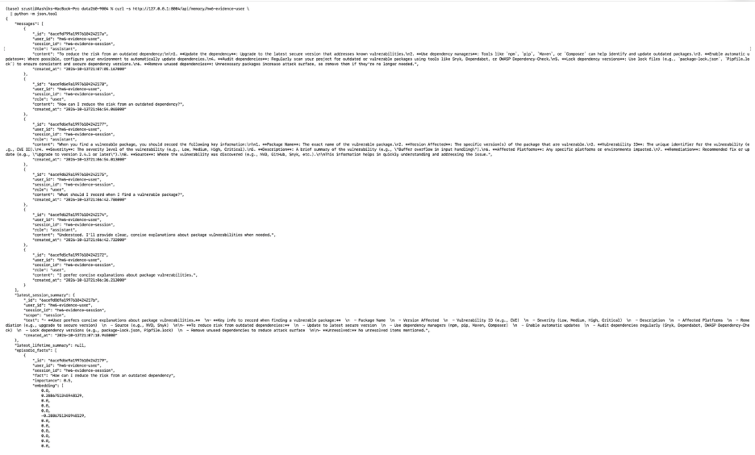

# DATA-260 Homework 6

Name: Shrusti Shetty  
SID4: 9004  
Repository: https://github.com/shrustishetty-2401/data260-9004  
Collaborators: Sbnikitha and supriyaselvanganesan

## Section 0 - Configuration

- SID4: 9004
- PORT_BASE: 8004
- PREFIX: `s9004`
- SEED: 9004
- VERIFY_SEED: 269004
- DOMAIN_ID: 4
- Domain: Open-source package vulnerabilities
- Hardware: Apple Silicon MacBook Pro
- Local model: Ollama `qwen3:8b`
- MongoDB version: MongoDB 7
- Final HW6 tag: `hw6`
- Final tagged commit: `903a35f2e2dee4bc218a53a91c42aebb7566f86f`

## Part 1 - MongoDB Document API

### Database and schema

The MongoDB database is `s9004_doc`, created with MongoDB 7 and PyMongo. The main collection is `vulnerabilities`.

The API schema includes:

- Required `title` with a maximum length of 100 characters.
- Optional `description`.
- Required `severity`.
- Required `discovered_at`.
- Automatic `created_at` and `updated_at` timestamps.
- Severity values: `low`, `medium`, `high`, and `critical`.
- Status values: `open`, `triaged`, and `resolved`.
- Default status: `open`.

API-level validation is implemented with Pydantic models.

```python
class VulnerabilityCreate(BaseModel):
    title: str = Field(min_length=1, max_length=100)
    description: str | None = None
    severity: Severity
    status: VulnerabilityStatus = VulnerabilityStatus.OPEN
    discovered_at: datetime
```

Implemented endpoints:

- `POST /api/documents`
- `GET /api/documents`
- `GET /api/documents/{id}`
- `PUT /api/documents/{id}`
- `DELETE /api/documents/{id}`

The endpoint implementation converts string IDs into MongoDB `ObjectId` values, returns HTTP 404 for missing records, updates `updated_at`, and returns HTTP 204 after successful deletion.

```python
@router.get("", response_model=list[VulnerabilityResponse])
def get_all_documents():
    documents = vulnerabilities_collection.find().sort(
        "created_at",
        -1,
    )
    return [
        serialize_document(document)
        for document in documents
    ]


@router.put(
    "/{document_id}",
    response_model=VulnerabilityResponse,
)
def update_document(
    document_id: str,
    payload: VulnerabilityUpdate,
):
    object_id = get_object_id(document_id)
    changes = payload.model_dump(exclude_unset=True)
    changes["updated_at"] = utc_now()

    result = vulnerabilities_collection.update_one(
        {"_id": object_id},
        {"$set": changes},
    )

    if result.matched_count == 0:
        raise HTTPException(
            status_code=404,
            detail="Document not found",
        )

    return serialize_document(
        vulnerabilities_collection.find_one(
            {"_id": object_id}
        )
    )


@router.delete(
    "/{document_id}",
    status_code=204,
)
def delete_document(document_id: str):
    result = vulnerabilities_collection.delete_one(
        {"_id": get_object_id(document_id)}
    )

    if result.deleted_count == 0:
        raise HTTPException(
            status_code=404,
            detail="Document not found",
        )

    return Response(status_code=204)
```

CORS middleware allows the existing frontend origins, including `localhost:5173` and `localhost:9191`. The backend is organized into separate files for API configuration, MongoDB connection management, Pydantic schemas, and route handlers.

Validation tests confirmed:

- Invalid severity values return HTTP 422.
- Missing required titles return HTTP 422.
- Invalid date values return HTTP 422.
- Numeric title values return HTTP 422.
- Missing document IDs return HTTP 404.


## Part 2 - MongoDB Conversational Memory

The memory system uses these MongoDB collections:

- `messages`
- `summaries`
- `episodes`

The `/api/chat` endpoint:

- Stores user messages.
- Builds a short-term conversation window.
- Loads the latest session summary.
- Loads the lifetime user summary.
- Extracts up to three facts from each user message.
- Assigns importance values to extracted facts.
- Creates deterministic local embeddings.
- Retrieves relevant episodic facts using cosine similarity.
- Calls the local Ollama `qwen3:8b` model.
- Stores the assistant response.
- Records prompt tokens, completion tokens, total tokens, and latency.
- Creates session and lifetime summaries every three user messages.

Configuration values:

- `SHORT_TERM_N=12`
- `EPISODE_TOP_K=3`
- `SUMMARIZE_EVERY_USER_MSGS=3`
- Embedding method: deterministic local hashed word-vector embedding.
- Similarity method: cosine similarity.

The prompt combines the system primer, lifetime summary, session summary, episodic facts, recent short-term messages, and the current user question.

```python
context_parts = [SYSTEM_PRIMER]

if lifetime_summary:
    context_parts.append(
        f"Lifetime summary:\n"
        f"{lifetime_summary['text']}"
    )

if session_summary:
    context_parts.append(
        f"Session summary:\n"
        f"{session_summary['text']}"
    )

if episodes:
    facts = "\n".join(
        f"- {episode['fact']}"
        for episode in episodes
    )
    context_parts.append(
        f"Episodic facts:\n{facts}"
    )

prompt_messages = [
    {
        "role": "system",
        "content": "\n\n".join(context_parts),
    }
]
```

Facts and episodic retrieval are implemented as follows:

```python
def extract_facts(message: str) -> list[str]:
    parts = [
        part.strip()
        for part in re.split(
            r"[.!?]+",
            message,
        )
        if part.strip()
    ]

    facts = []

    for part in parts[:3]:
        fact = part[:240]
        if fact and fact not in facts:
            facts.append(fact)

    return facts


def get_relevant_episodes(
    user_id: str,
    message: str,
) -> list[dict]:
    query_embedding = embed_text(message)

    candidates = list(
        episodes_collection.find(
            {"user_id": user_id}
        )
    )

    for episode in candidates:
        episode["similarity"] = round(
            cosine_similarity(
                query_embedding,
                episode.get("embedding", []),
            ),
            4,
        )

    candidates.sort(
        key=lambda item: (
            item.get("similarity", 0),
            item.get("importance", 0),
        ),
        reverse=True,
    )

    return candidates[:EPISODE_TOP_K]
```

Summarization is triggered every three user messages:

```python
if (
    user_message_count
    % SUMMARIZE_EVERY_USER_MSGS
    == 0
):
    summarize_session(
        payload.user_id,
        payload.session_id,
    )

    summarize_lifetime(
        payload.user_id,
    )

    summary_created = True
```

A ten-message conversation was completed successfully. The memory response contained messages, session summaries, lifetime summaries, episodic facts, embeddings, and JSON-safe string IDs.

```python
@router.get("/api/memory/{user_id}")
def get_memory(user_id: str):
    return make_json_safe({
        "messages": messages,
        "latest_session_summary": session_summary,
        "latest_lifetime_summary": lifetime_summary,
        "episodic_facts": episodes,
    })


@router.get("/api/aggregate/{user_id}")
def get_aggregate(user_id: str):
    return make_json_safe({
        "daily_message_counts": daily_counts,
        "recent_summaries": recent_summaries,
    })
```

The memory endpoint returns recent messages, summaries, and episodic facts. The aggregate endpoint returns daily message counts and recent summaries.


## Part 3 - Memory Costs and Experiments

Each experiment used a fresh user and session with a 30-message conversation followed by five memory probes.

| Setting | Mean prompt tokens/turn | Mean latency (ms) | Probe quality |
|---|---:|---:|---:|
| `SHORT_TERM_N=4` | 286.97 | 5000.13 | 3.0 |
| `SHORT_TERM_N=12` | 614.17 | 9255.64 | 2.8 |
| `SHORT_TERM_N=30` | 1020.77 | 12746.58 | 2.8 |
| Eviction policy, `N=12` | 685.40 | 10635.50 | 3.0 |

The eviction policy limits stored episodic facts to the most recent ten facts per user. This bounds database growth. It did not reduce prompt cost in this single run because retrieval already limits the prompt to `EPISODE_TOP_K=3` episodic facts.

Per-request metrics include component-level estimates:

```json
{
  "prompt_tokens": 2209,
  "completion_tokens": 262,
  "total_tokens": 2471,
  "system_primer_tokens": 26,
  "long_term_summary_tokens": 257,
  "short_term_window_tokens": 1146,
  "episodic_facts_tokens": 27,
  "latency_ms": 33194.29
}
```

Probe questions and keyword-based scoring were recorded in `memory_probes.yaml`.

```yaml
- id: preference
  question: How does the user prefer explanations?
  expected: [concise, open-source]

- id: recording
  question: What should be recorded for a vulnerable package?
  expected: [package, severity, version]

- id: severity
  question: Which severity levels should be prioritized first?
  expected: [critical, high]

- id: transitive
  question: Why are transitive dependencies important?
  expected: [indirect, vulnerabilities]

- id: no_patch
  question: What should be done when no patch exists?
  expected: [replace, workaround]
```

The probe score used a 1–5 scale based on the number of expected keywords found in the response.

Estimated costs for 10,000 thirty-turn conversations were calculated using:

- Prompt tokens: `$1.00 / 1,000,000 tokens`
- Completion tokens: `$5.00 / 1,000,000 tokens`

| Setting | Mean completion tokens/turn | Estimated cost |
|---|---:|---:|
| `SHORT_TERM_N=4` | 37.93 | $142.99 |
| `SHORT_TERM_N=12` | 50.13 | $259.45 |
| `SHORT_TERM_N=30` | 44.20 | $372.53 |
| Eviction policy, `N=12` | 57.03 | $291.17 |

`SHORT_TERM_N=4` had the lowest prompt-token usage, latency, and estimated cost while maintaining a probe score of 3.0.

`SHORT_TERM_N=30` had the highest prompt-token usage, latency, and estimated cost. Its probe score was 2.8, which did not improve over the smaller windows. This was a single run with a small probe set, so the difference may include model and run-to-run variation.

The eviction policy did not reduce cost compared with baseline `N=12` in this run. Its purpose was bounded episodic-memory growth.


## Part 4 - File-Based Memory

`AGENT.md` contains:

- Project description.
- Technology stack.
- Coding conventions.
- Testing approach.
- Prohibited actions.
- Code review formatting requirements.

`MEMORY.md` was initially created with duplicate and contradictory facts. The original file had 55 physical lines. The consolidation process created `reports/hw06/MEMORY_original.md`, resolved duplicate facts, recorded explicit contradiction decisions, and reduced the consolidated `MEMORY.md` to 38 physical lines, below the required 40-line limit.

The three contradictions were handled explicitly:

1. Concise versus detailed explanations:
   - Retained concise explanations because that is the current project preference.
   - Marked detailed explanations as superseded.
   - Verification is required if the preference changes.

2. Open versus resolved package status:
   - Retained resolved as the operational status.
   - Marked the decision as potentially incorrect because the original facts had no timestamps.
   - Verification against the current package record is required.

3. MongoDB versus MySQL memory:
   - Retained MongoDB for HW6 memory.
   - Marked MySQL as incorrect for HW6, while recognizing that MySQL remains part of the earlier SQL application.

The file-memory prompt loads both project instructions and durable memory:

```python
def build_file_memory_prompt() -> str:
    return (
        f"Project instructions:\n"
        f"{load_agent()}\n\n"
        f"Durable memory:\n"
        f"{load_memory()}"
    )
```

The consolidation rule checks both the line count and the timestamp:

```python
def consolidation_required() -> bool:
    lines_exceed_limit = (
        len(non_empty_memory_lines()) > 40
    )

    timestamp = get_consolidation_timestamp()

    older_than_one_day = (
        timestamp is None
        or datetime.now(timezone.utc) - timestamp
        > timedelta(hours=24)
    )

    return (
        lines_exceed_limit
        or older_than_one_day
    )
```

The required commands are:

- `/memory`
- `/compact`
- `/dream`
- `/help`

```python
def memory_command(
    command: str,
    recent_conversation: str = "",
) -> dict:
    if command == "/memory":
        return {
            "command": command,
            "memory": load_memory(),
        }

    if command == "/compact":
        result = consolidate_memory()
        return {
            "command": command,
            "details": result,
        }

    if command == "/dream":
        facts = [
            line.strip()
            for line in recent_conversation.splitlines()
            if line.strip()
        ]
        return {
            "command": command,
            "added_facts": facts[:3],
        }

    if command == "/help":
        return {
            "command": command,
            "commands": {
                "/memory": "Display file-based memory.",
                "/compact": "Consolidate MEMORY.md.",
                "/dream": "Save useful recent facts.",
                "/help": "Display available commands.",
            },
        }
```

The type-hinted file-memory functions use UTC timestamps and were verified against the project instructions in `AGENT.md`.


## MongoDB and File-Based Memory Comparison

| Criterion | MongoDB-backed memory | File-based memory |
|---|---|---|
| Inspectability | Structured collections with timestamps, embeddings, and summaries. | Directly readable Markdown files. |
| Persistence after restart | Persists in MongoDB across API restarts. | Persists in `AGENT.md` and `MEMORY.md`. |
| Scalability | Better for many users and sessions. | Less scalable as one file grows. |
| Retrieval | Supports queryable messages, summaries, and episodic facts. | Best for durable instructions and verified facts. |
| Facts that must not be forgotten | Lifetime summaries and episodic records. | Stable instructions and manually verified facts. |

MongoDB memory is better for conversational history, retrieval, and multiple sessions. File-based memory is better for stable instructions and durable facts that should remain visible and inspectable.

## Verification

The HW6 verification script passed all checks:

- FastAPI health endpoint.
- `POST /api/chat`.
- MongoDB document list endpoint.
- MongoDB document creation endpoint.
- MongoDB document deletion endpoint.
- Memory endpoint.
- Aggregate endpoint.

The result was:

```json
{
  "homework": "HW6",
  "sid4": 9004,
  "model": "qwen3:8b",
  "SEED": 9004,
  "VERIFY_SEED": 269004,
  "passed": true
}
```

The verification output is stored in:

- `reports/hw06/verification.json`

## AI Use

See `AI_USE.md`.

AI assistance was used to help plan the implementation, write FastAPI and PyMongo code, design memory retrieval and summarization logic, prepare experiment scripts, and organize the report.

One unsuitable result was the initial memory endpoint response. It failed because MongoDB `ObjectId` values were not JSON serializable. The problem was detected by calling `GET /api/memory/student-9004` and checking the FastAPI traceback.

The issue was fixed by adding a recursive `make_json_safe` function that converts `ObjectId` values to strings before returning API responses. The memory and aggregate endpoints were then recompiled and verified successfully.

## Raw Evidence

The following reproducible evidence files are included:

- `raw/chat_metrics.jsonl`
- `raw/experiment_short_term_4.json`
- `raw/experiment_short_term_12.json`
- `raw/experiment_short_term_30.json`
- `raw/experiment_eviction_12.json`
- `raw/memory_student-9004.json`
- `raw/aggregate_student-9004.json`
- `raw/memory_hw6-evidence-user.json`
- `raw/aggregate_hw6-evidence-user.json`
- `raw/memory_lifetime-test.json`
- `memory_probes.yaml`
- `verification.json`
- `RUN_LOG.txt`
- `METRICS.md`
- `AI_USE.md`

## Evidence Screenshots

### MongoDB Collections and Sample Documents


### Successful CRUD Operations


### Validation Errors


### Chat Conversation


### Memory Endpoint





### Aggregate Endpoint


### File-Based Memory Commands


### AGENT.md Function Verification

