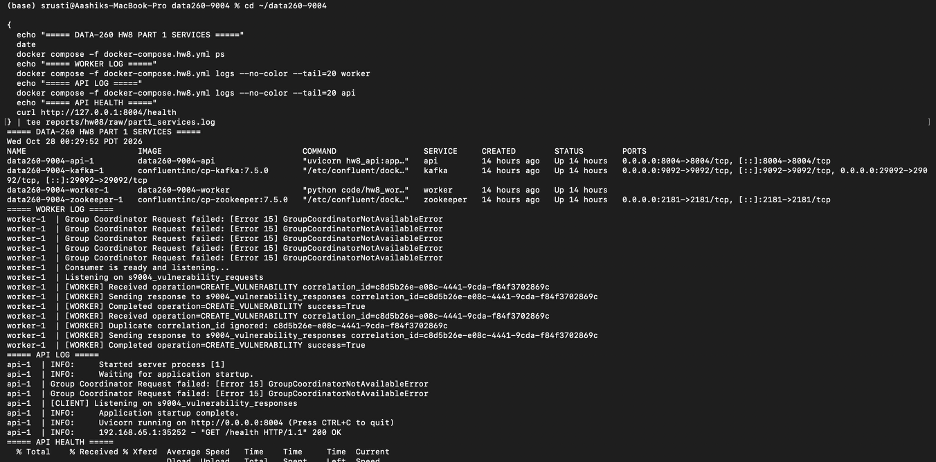
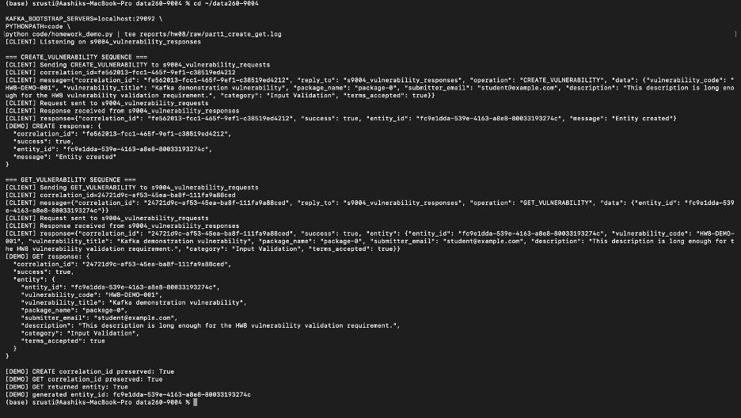
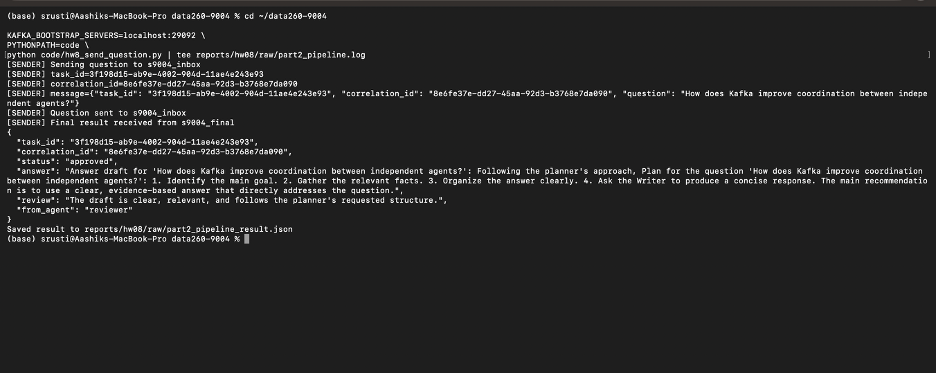
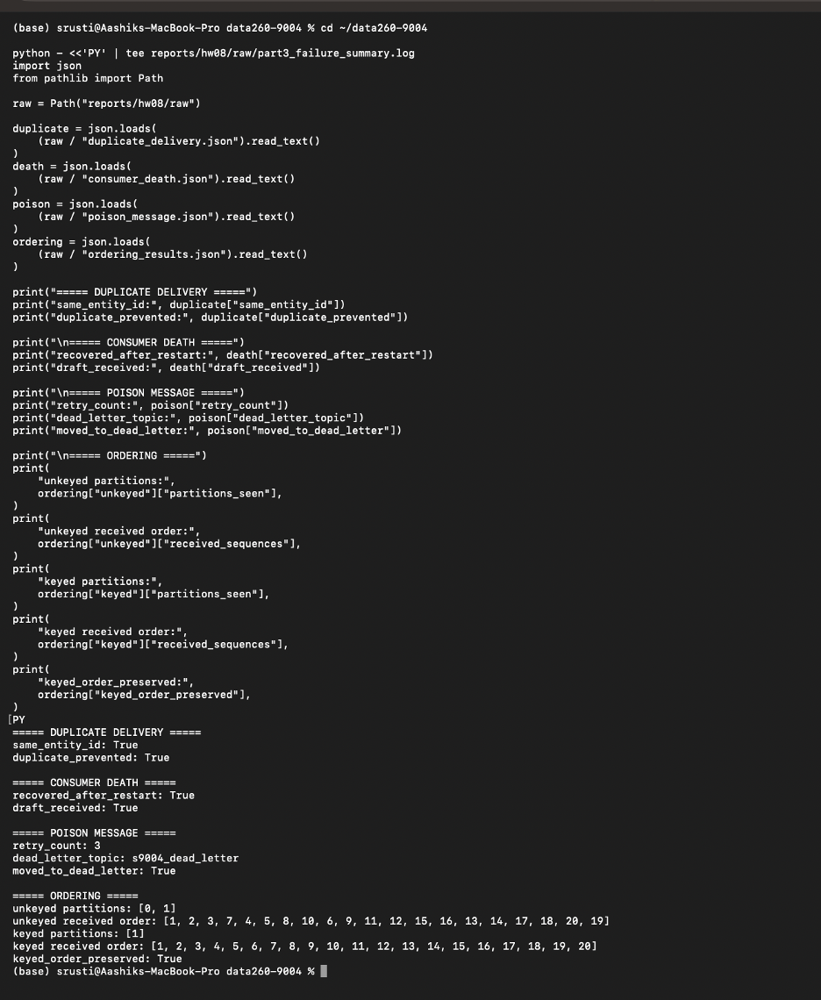

# DATA-260 Homework 8

GitHub repository: https://github.com/shrustishetty-2401/data260-9004

## Student and Configuration

- Student: Shrusti Shetty
- SID4: 9004
- PORT_BASE: 8004
- PREFIX: `s9004`
- SEED: 9004
- VERIFY_SEED: 269004
- DOMAIN_ID: 4
- Hardware: MacBook Pro, Apple Silicon
- Local model: `qwen3:8b`
- Final branch: `hw8`
- Final tag: `hw8`

## Part 1: Kafka Vulnerability Request/Response Service

The primary domain entity is `Vulnerability`.

The worker stores entities in an in-memory dictionary. Clients communicate with the worker only through Kafka.

### Kafka Topics

- `s9004_vulnerability_requests`
- `s9004_vulnerability_responses`

### Request Schema

```json
{
  "correlation_id": "unique-request-id",
  "reply_to": "s9004_vulnerability_responses",
  "operation": "CREATE_VULNERABILITY",
  "data": {
    "vulnerability_code": "HW8-DEMO-001",
    "vulnerability_title": "Kafka demonstration vulnerability",
    "package_name": "package-0",
    "submitter_email": "student@example.com",
    "description": "A sufficiently long vulnerability description.",
    "category": "Input Validation",
    "terms_accepted": true
  }
}
```

### Response Schema

Successful CREATE and GET responses use the following structure:

```json
{
  "correlation_id": "same-request-id",
  "success": true,
  "entity_id": "uuid",
  "entity": {
    "vulnerability_code": "HW8-DEMO-001",
    "vulnerability_title": "Kafka demonstration vulnerability",
    "package_name": "package-0",
    "submitter_email": "student@example.com",
    "description": "A sufficiently long vulnerability description.",
    "category": "Input Validation",
    "terms_accepted": true
  }
}
```

Error responses preserve the correlation ID and include an error message:

```json
{
  "correlation_id": "same-request-id",
  "success": false,
  "error": "Entity not found"
}
```

### Functionality

- CREATE vulnerability requests
- GET vulnerability requests
- UUID entity identifiers
- Correlation IDs preserved in every response
- Input validation
- Unknown-operation errors
- Missing-entity errors
- Duplicate correlation handling

The CREATE then GET demonstration succeeded. The GET request returned the created vulnerability entity, and correlation IDs were preserved.





Evidence:

- `raw/part1_create_get.log`
- `raw/part1_error_tests.json`
- `raw/part1_services.log`

## Part 2: Multi-Agent Kafka Pipeline

Implemented separate Planner, Writer, and Reviewer processes.

### Kafka Topics

- `s9004_inbox`
- `s9004_tasks`
- `s9004_drafts`
- `s9004_final`

### Agent Responsibilities

- Planner receives the question and creates a plan.
- Writer creates an answer draft.
- Reviewer evaluates the draft.
- Approved results are published to the final topic.

The pipeline completed successfully with status `approved`. The task ID and correlation ID were preserved through the pipeline.



Evidence:

- `raw/part2_pipeline_result.json`
- `raw/part2_pipeline.log`
- `RUN_LOG.txt`

## Part 3: Reliability, Failure Handling, and Ordering

### Duplicate Delivery and Idempotency

The same CREATE request was delivered twice. Both responses returned the same entity ID.

- `same_entity_id`: `true`
- `duplicate_prevented`: `true`

Evidence:

- `raw/duplicate_delivery.json`

### Consumer Death and Recovery

The Writer was stopped during a simulated long-running task. After restarting the Writer, Kafka redelivered the uncommitted message and the task completed successfully.

- `recovered_after_restart`: `true`
- `draft_received`: `true`

Evidence:

- `raw/consumer_death.json`

### Poison Messages and Dead-Letter Handling

Poison messages intentionally failed processing. The Writer retried each message three times and then moved it to the dead-letter topic.

- Retry limit: 3
- Dead-letter topic: `s9004_dead_letter`
- `moved_to_dead_letter`: `true`

Evidence:

- `raw/poison_message.json`

### Kafka Ordering

Twenty unkeyed and twenty keyed messages were tested.

| Case | Partitions | Order preserved |
|---|---:|---|
| Unkeyed messages | 2 | No |
| Keyed messages | 1 | Yes |

The ordering experiment used two Kafka partitions and two consumer processes. Unkeyed messages were distributed across partitions and were not globally ordered. Keyed messages used the same entity key, were routed to one partition, and preserved their order.

- `keyed_order_preserved`: `true`
- Verification seed: `269004`



Evidence:

- `raw/ordering_results.json`
- `raw/part3_failure_summary.log`

## Kafka Reliability Conclusions

Kafka provides:

- Durable message storage
- Consumer-group coordination
- Redelivery of uncommitted messages
- Retry and dead-letter processing
- Correlation between requests and responses
- Per-key ordering through partition assignment
- Decoupling between independent services

The producer is responsible for publishing valid messages and using stable keys when ordering matters. The consumer is responsible for validation, idempotency, retries, offset commits, and dead-letter handling.

### Comparison with HW2

HW2 used a simpler request/response workflow. HW8 extends that design with Kafka topics, independent consumers, consumer groups, offset commits, retries, dead-letter handling, idempotency, consumer restart recovery, and key-based ordering.

Kafka adds durable asynchronous coordination, but it also requires explicit handling of commits, retries, duplicate messages, consumer failures, and ordering.

## Reproducibility Evidence

- `RUN_LOG.txt`
- `METRICS.md`
- `AI_USE.md`
- `verification.json`
- `raw/part1_create_get.log`
- `raw/part1_error_tests.json`
- `raw/part1_services.log`
- `raw/part2_pipeline_result.json`
- `raw/part2_pipeline.log`
- `raw/duplicate_delivery.json`
- `raw/consumer_death.json`
- `raw/poison_message.json`
- `raw/ordering_results.json`
- `raw/part3_failure_summary.log`

## Final Verification

The verification script reported:

- API health: passed
- Part 1 CREATE/GET evidence: passed
- Part 1 error tests: passed
- Part 2 pipeline approval: passed
- Duplicate delivery prevention: passed
- Consumer death recovery: passed
- Poison dead-letter handling: passed
- Keyed ordering preservation: passed
- Required evidence directory: passed

Overall result: `all_passed: true`

## Submission Files

The final report PDF is:

`reports/hw08/Shetty_HW8.pdf`

The final submission includes the implementation, Docker/Kafka configuration, tests, screenshots, raw JSON results, logs, metrics, AI-use documentation, verification output, and the final PDF.
