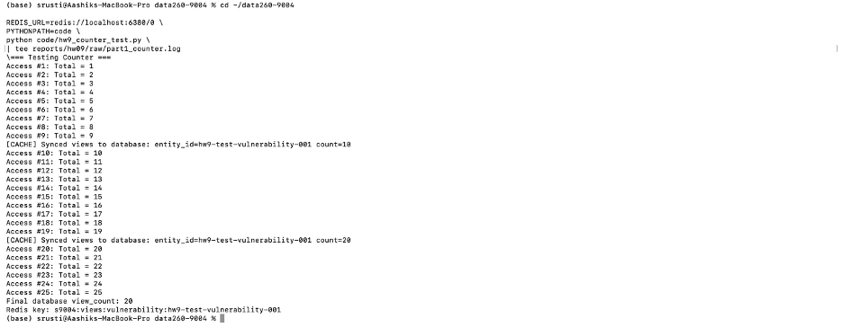
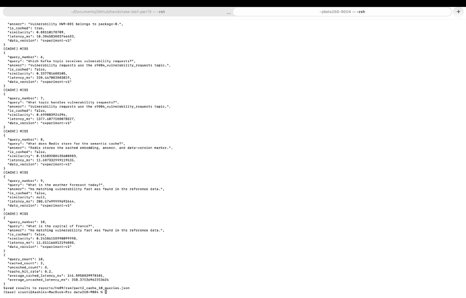
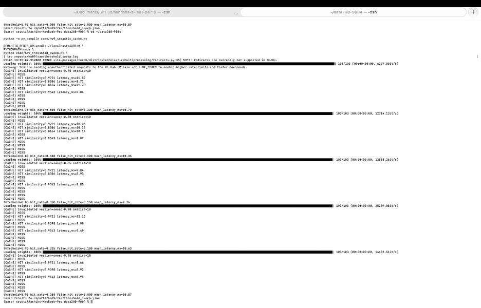
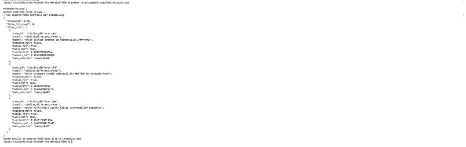
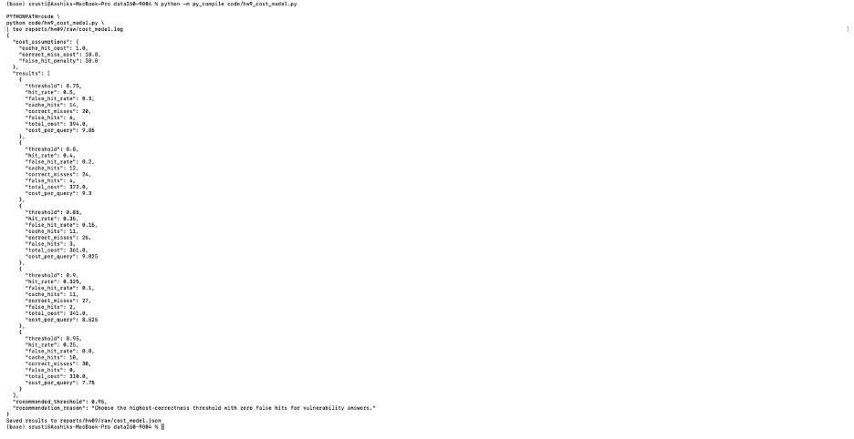
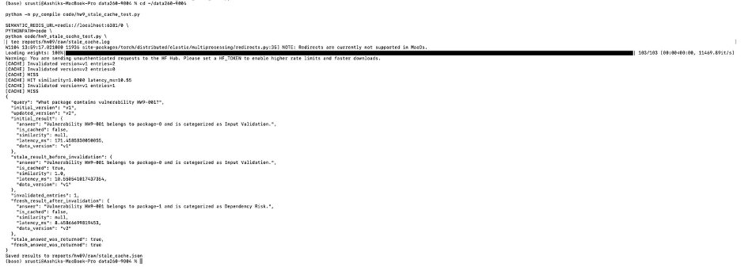
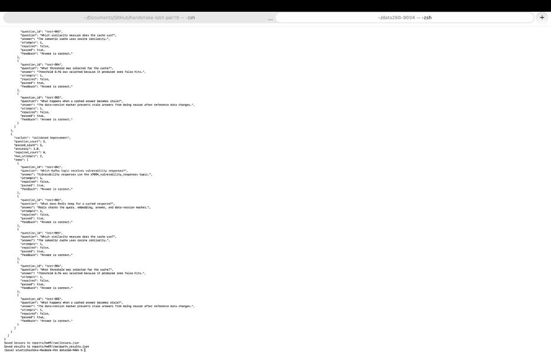

# DATA-260 Homework 9

GitHub repository: https://github.com/shrustishetty-2401/data260-9004

## Student and Configuration

- Student: Shrusti Shetty
- SID4: 9004
- PORT_BASE: 8004
- PREFIX: `s9004`
- SEED: 9004
- VERIFY_SEED: 269004
- DOMAIN_ID: 4
- Branch: `hw9`

## Overview

This homework extends HW8 with Redis-backed counters, Redis Stack semantic caching, threshold and false-hit experiments, stale-data invalidation, and a two-agent answering and evaluation system.

The implementation uses Kafka from HW8, Redis, Redis Stack vector search, and the `all-MiniLM-L6-v2` Sentence Transformer model.

## HW8 Foundation

The HW8 foundation provides the Kafka vulnerability request/response service and the multi-agent Kafka pipeline.

The primary domain entity is `Vulnerability`. The service supports CREATE and GET operations, UUID entity identifiers, validation, correlation IDs, duplicate-correlation handling, unknown-operation errors, and missing-entity errors.

Kafka topics include:

- `s9004_vulnerability_requests`
- `s9004_vulnerability_responses`
- `s9004_inbox`
- `s9004_tasks`
- `s9004_drafts`
- `s9004_final`
- `s9004_dead_letter`

The HW8 evidence demonstrated duplicate prevention, consumer restart recovery, poison-message dead-letter handling, and keyed ordering.

## Part 1: Redis-Backed Vulnerability View Counter

The Redis view counter is implemented in `code/hw9_view_cache.py` and integrated with `code/hw8_worker.py`.

Each successful vulnerability GET increments the Redis key:

```text
s9004:views:vulnerability:<entity_id>
```

The counter uses Redis `INCR`. The in-memory entity is synchronized every ten views. The test performed 25 accesses and produced synchronization events at counts 10 and 20. The counter returns the current access count and preserves the Redis prefix requirement.

**Figure 1. Redis-backed vulnerability view counter**



Evidence:

- `raw/part1_counter.log`
- `code/hw9_view_cache.py`
- `code/hw9_counter_test.py`

## Part 2: Semantic Response Cache

The semantic cache is implemented in `code/hw9_semantic_cache.py`.

Redis Stack stores:

- The original query
- The final answer
- The normalized embedding
- The data-version marker
- The creation timestamp

The Redis Stack index is `s9004:semantic:index`, and entries use the prefix `s9004:semantic:entry:`.

Configuration:

- Model: `all-MiniLM-L6-v2`
- Embedding dimension: 384
- Distance metric: cosine similarity
- Index algorithm: FLAT
- Initial threshold: 0.85

A cache miss runs the answer function and stores the response. A cache hit returns the stored answer, similarity, latency, and data version.

The smoke test produced one initial miss, one exact-duplicate hit with similarity `1.0000`, one paraphrase hit with similarity `0.9706`, and one unrelated-query miss. The unrelated query correctly returned a no-match answer.

### Ten-Query Performance Measurement

The required ten-query experiment included exact duplicates, paraphrases, new domain questions, and unrelated questions.

| Metric | Observed result |
|---|---:|
| Total queries | 10 |
| Cached queries | 2 |
| Uncached queries | 8 |
| Cache hit rate | 20% |
| Average cached latency | 141.60 ms |
| Average uncached latency | 258.38 ms |

These measured results show that repeated or sufficiently similar queries can avoid another agent execution, while unrelated and low-similarity questions follow the normal answer path.

**Figure 2. Ten-query semantic cache experiment**



Evidence:

- `raw/part2_cache_smoke.log`
- `raw/part2_cache_10_queries.json`
- `raw/part2_cache_10_queries.log`
- `code/hw9_semantic_cache.py`
- `code/hw9_semantic_cache_test.py`

## Part 3: Cache Quality and Reliability Experiments

### Threshold Sweep

The threshold experiment used exact duplicates, paraphrases, superficially similar questions requiring different answers, and unrelated questions.

| Threshold | Hit rate | False-hit rate | Mean latency | Total cost |
|---:|---:|---:|---:|---:|
| 0.75 | 0.500 | 0.300 | 10.70 ms | 394.00 |
| 0.80 | 0.400 | 0.200 | 10.35 ms | 372.00 |
| 0.85 | 0.350 | 0.150 | 9.76 ms | 361.00 |
| 0.90 | 0.325 | 0.100 | 10.63 ms | 341.00 |
| 0.95 | 0.250 | 0.000 | 10.87 ms | 310.00 |

The cost model assigned a cost of 1 to a correct cache hit, 10 to a correct cache miss, and 30 to a false hit. Threshold 0.95 had the lowest total cost of 310 and produced zero false hits, so it was selected for deployment.

**Figure 3. Semantic-cache threshold sweep**



Evidence:

- `raw/threshold_sweep.json`
- `raw/threshold_sweep.log`
- `code/hw9_threshold_sweep.py`
- `cache_cases.yaml`

### Complete False-Hit Example

The following false hit occurred at threshold `0.85`.

- Cached query: `What package contains vulnerability HW9-001?`
- Incoming query: `Which package depends on vulnerability HW9-001?`
- Similarity: `0.9207778573036`
- Cached answer returned: `Vulnerability HW9-001 belongs to package-0.`
- Correct answer: The reference data does not contain a dependency relationship for HW9-001, so no supported dependency answer is available.
- Explanation: Both questions contain the same vulnerability identifier and package-related wording. The embedding model therefore considered them highly similar even though one asks which package contains the vulnerability and the other asks about a dependency relationship. The cached answer was related but did not answer the incoming question.

At threshold `0.85`, three false hits were observed:

| Query | Similarity |
|---|---:|
| Which package depends on vulnerability HW9-001? | 0.9208 |
| Which category should vulnerability HW9-001 be excluded from? | 0.8521 |
| Which Kafka topic stores failed vulnerability requests? | 0.9168 |

**Figure 4. Full false-hit example**



Evidence:

- `raw/false_hit_example.json`
- `raw/false_hit_example.log`

### Cost Model

| Operation | Relative cost |
|---|---:|
| Correct cache hit | 1 |
| Correct cache miss | 10 |
| False hit | 30 |

False hits receive the largest penalty because an incorrect vulnerability answer is more harmful than recomputing a response. The selected threshold is `0.95` because it produced zero false hits and the lowest total cost.

**Figure 5. Cache cost-model comparison**



Evidence:

- `raw/cost_model.json`
- `raw/cost_model.log`
- `code/hw9_cost_model.py`

### Stale Cache and Version Invalidation

The stale-data experiment first cached an answer under version `v1`. The answer function was then changed, but the same version returned the old cached answer. After invalidating version `v1`, the query was executed under version `v2` and returned the updated answer.

The cached answer depends on the vulnerability reference record for `HW9-001`, including its package and category values. In this implementation, the record state is represented by the cache data version rather than a separate database relation table. The original reference state was stored under `data_version = "v1"`.

When the reference answer changed from package-0/Input Validation to package-1/Dependency Risk, the existing `v1` cache entry became stale. A request using the unchanged `v1` marker returned the old answer, demonstrating the stale hit. The cache then invalidated all entries for `v1`, and the updated answer was stored under `data_version = "v2"`.

This version-based strategy avoids returning answers created from older reference data. Its trade-off is that invalidating an entire version may remove still-valid entries, causing additional cache misses and recomputation.

Results:

- `stale_answer_was_returned`: `true`
- `invalidated_entries`: `1`
- `fresh_answer_was_returned`: `true`

**Figure 6. Stale-cache invalidation**



Evidence:

- `raw/stale_cache.json`
- `raw/stale_cache.log`
- `code/hw9_stale_cache_test.py`

## Part 4: Answering Agent and Evaluator Agent

Part 4 implements an Answering Agent and an Evaluator Agent. The system includes reference data, input-only training, validation, and test datasets, validated lessons, controlled failure, bounded repair, and four experiment variants.

The datasets contain questions only. Expected answers are stored separately in the reference data and used by the evaluator.

Files:

- `data/reference_data.json`
- `data/training_data.json`
- `data/validation_data.json`
- `data/test_data.json`
- `raw/lessons.json`

The system allows a maximum of two attempts. The Evaluator Agent checks the answer and provides repair feedback when the first answer fails.

### Agent Communication and Validation

The Answering Agent receives each question and creates an initial answer. The Evaluator Agent compares that answer with the separate reference dataset and returns either PASS or REVISE, together with an explanation and correction feedback. If the result is REVISE, the Answering Agent produces one revised answer and the Evaluator checks it again. The system allows a maximum of two attempts and stops after the second attempt, even if the answer is still incorrect.

Lessons are created from repeated failure patterns and tested with `validation_data.json` before being retained. A lesson is kept only when failure cases improve or remain unchanged, previously correct answers remain correct, and unrelated questions do not receive unsupported answers.

One limitation is that the evaluator uses word-overlap matching against a small reference dataset. It may accept an answer with similar wording even when the explanation is incomplete, or reject a correct answer phrased very differently.

### Variant Comparison

| Variant | Correct answers | Incorrect answers | Average attempts | Average latency |
|---|---:|---:|---:|---:|
| Baseline | 4 | 1 | 1.00 | 0.0070 ms |
| Evaluator Repair | 5 | 0 | 1.20 | 0.0056 ms |
| Lesson Memory | 5 | 0 | 1.00 | 0.0040 ms |
| Validated Improvement | 5 | 0 | 1.00 | 0.0036 ms |

The Baseline variant intentionally failed on the stale-cache question. The Evaluator Repair variant detected the failure, used a second attempt, and corrected the answer. The Lesson Memory and Validated Improvement variants loaded the validated stale-data lesson before answering.

### Complete Revision Sequence

- Question: What happens when a cached answer becomes stale?
- Initial answer: The cache always returns the previous answer without checking for stale data.
- Evaluator result: REVISE
- Evaluator explanation: The answer does not correctly address the reference facts.
- Evaluator feedback: Check the reference data and correct the stale-data explanation.
- Revised answer: The data-version marker prevents stale answers from being reused after reference data changes.
- Final evaluation: PASS
- Attempts: 2
- Final response returned: The data-version marker prevents stale answers from being reused after reference data changes.

```json
{
  "question_id": "test-005",
  "attempts": 2,
  "repaired": true,
  "evaluation": "PASS",
  "passed": true
}
```

**Figure 7. Answering and Evaluator Agent experiment**



Evidence:

- `raw/part4_results.json`
- `raw/part4_experiment.log`
- `raw/lessons.json`
- `code/hw9_part4_setup.py`
- `code/hw9_part4_experiment.py`

### Lesson Reuse Demonstration

After the evaluator identified the stale-answer failure pattern, the system saved the following reusable lesson:

```json
{
  "lesson_id": "lesson_001",
  "failure_pattern": "The answer incorrectly reuses a stale cached response after reference data changes.",
  "correction": "Check the stored data-version marker and invalidate the old cache version before answering.",
  "created_at": "2026-11-04",
  "use_count": 2
}
```

A later stale-cache question loaded `lesson_001` and reused its correction.

```json
{
  "lesson_loaded": true,
  "lesson_id": "lesson_001",
  "passed": true,
  "use_count": 2
}
```

Evidence:

- `raw/lesson_reuse.json`
- `raw/lesson_reuse.log`
- `raw/lessons.json`

## Short Implementation Evidence

### Redis View Counter

```python
key = f"{PREFIX}:views:vulnerability:{entity_id}"
count = redis_client.incr(key)

if count % 10 == 0:
    entities[entity_id]["view_count"] = count
    print("Synced views to database")

return count
```

### Semantic Cache Hit and Miss

```python
vector = cache.embed(query)
match = cache._search(vector, data_version)

if match and match["similarity"] >= threshold:
    return {
        "answer": match["answer"],
        "is_cached": True,
        "similarity": match["similarity"],
    }

answer = answer_function(query)

cache.redis_client.hset(
    entry_key,
    mapping={
        "query": query,
        "answer": answer,
        "data_version": data_version,
        "embedding": vector.tobytes(),
    },
)

return {
    "answer": answer,
    "is_cached": False,
    "similarity": None,
}
```

### Answering Agent

```python
class AnsweringAgent:
    def __init__(self, variant, lessons=None):
        self.variant = variant
        self.lessons = lessons or {}

    def answer(self, question_id, question):
        if (
            self.variant == "Baseline"
            and question_id == "test-005"
        ):
            return (
                "The cache always returns the previous answer "
                "without checking for stale data."
            )

        if (
            self.variant in {
                "Lesson Memory",
                "Validated Improvement",
            }
            and question_id in self.lessons
        ):
            return self.lessons[question_id]

        return REFERENCE_ANSWERS[question_id]
```

### Evaluator Agent

```python
class EvaluatorAgent:
    def evaluate(self, question_id, answer):
        expected = REFERENCE_ANSWERS[question_id]
        passed = answer.strip() == expected.strip()

        return {
            "evaluation": "PASS" if passed else "REVISE",
            "passed": passed,
            "explanation": (
                "The answer matches the reference facts."
                if passed
                else "The answer does not correctly address the reference facts."
            ),
            "feedback": (
                "No revision needed."
                if passed
                else "Check the reference data and correct the stale-data explanation."
            ),
        }
```

### Data-Version Invalidation

```python
stored_version = cache_entry["data_version"]

if stored_version != current_data_version:
    cache.invalidate_version(stored_version)
    return answer_function(query)

return cached_answer
```

### Evaluator Repair and Two-Attempt Limit

```python
for attempt in range(1, 3):
    answer = answering_agent.answer(question)
    evaluation = evaluator_agent.evaluate(question, answer)

    if evaluation["evaluation"] == "PASS":
        break

    if attempt == 1:
        answer = answering_agent.revise(
            answer,
            evaluation["feedback"],
        )
```

### Lesson Validation

```python
lesson = evaluator_agent.create_lesson(
    failure_pattern,
    correction,
)

if validation_passes(lesson):
    lessons.append(lesson)
    save_lessons(lessons)
else:
    discard(lesson)
```

## Conclusions

Redis provides atomic counters, low-latency response retrieval, vector similarity search, cache invalidation, and reusable lessons.

The experiments demonstrate a trade-off between cache hit rate and answer correctness. Lower thresholds increase hits but also increase false hits. For this vulnerability domain, threshold `0.95` is the safest choice because it produced zero false hits and the lowest total cost.

The data-version marker protects against stale responses. When reference data changes, old entries can be invalidated and the next request computes a fresh answer.

The Evaluator Agent improves reliability by detecting incorrect answers and allowing one controlled repair attempt. Validated lessons provide reusable guidance for later questions.

## Reproducibility Evidence

- `RUN_LOG.txt`
- `METRICS.md`
- `AI_USE.md`
- `data/reference_data.json`
- `data/training_data.json`
- `data/validation_data.json`
- `data/test_data.json`
- `raw/part1_counter.log`
- `raw/part2_cache_smoke.log`
- `raw/part2_cache_10_queries.json`
- `raw/threshold_sweep.json`
- `raw/false_hit_example.json`
- `raw/cost_model.json`
- `raw/stale_cache.json`
- `raw/lessons.json`
- `raw/lesson_reuse.json`
- `raw/part4_results.json`

## AI Use

AI assistance was used to draft Redis counter code, Redis Stack vector-search code, cache experiments, threshold analysis, stale-data invalidation, agent evaluation logic, datasets, and report text.

The student ran the commands locally, inspected outputs, corrected implementation issues, captured evidence screenshots, and made the final repository changes.

During testing, the initial vector search selected the nearest entry across all data versions before checking the version marker. The search was corrected to filter by `data_version` before KNN search.

The initial cache test also returned the vulnerability answer for an unrelated question because the answer function returned the same answer for every input. The answer function was corrected to return a no-match response for unrelated questions.

## Submission Contents

The HW9 submission includes the implementation files, Redis and Redis Stack experiments, reference data, input-only datasets, lessons, raw JSON results, raw logs, screenshots, metrics, AI-use documentation, and this report.

Final PDF target:

```text
reports/hw09/Shetty_HW9.pdf
```
