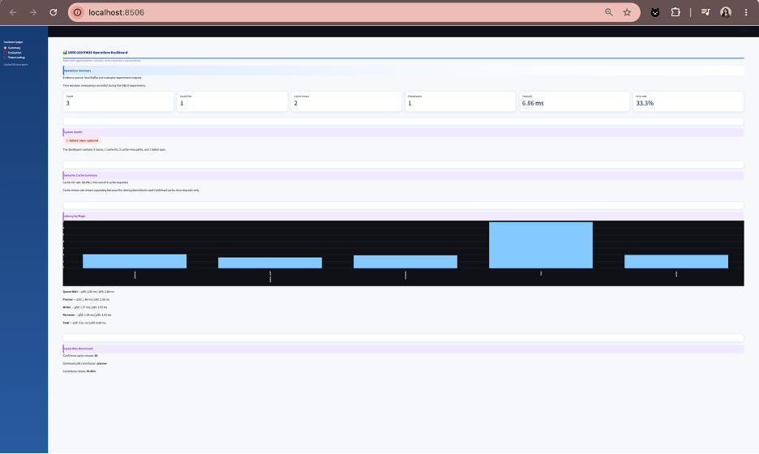
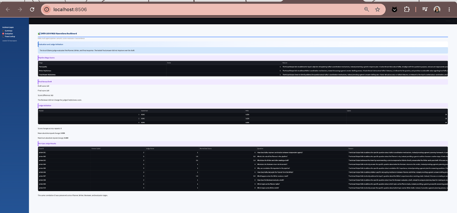
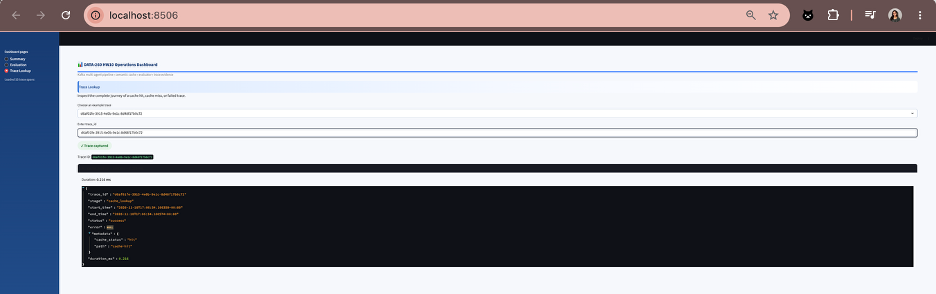
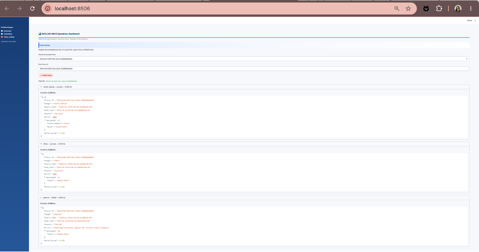
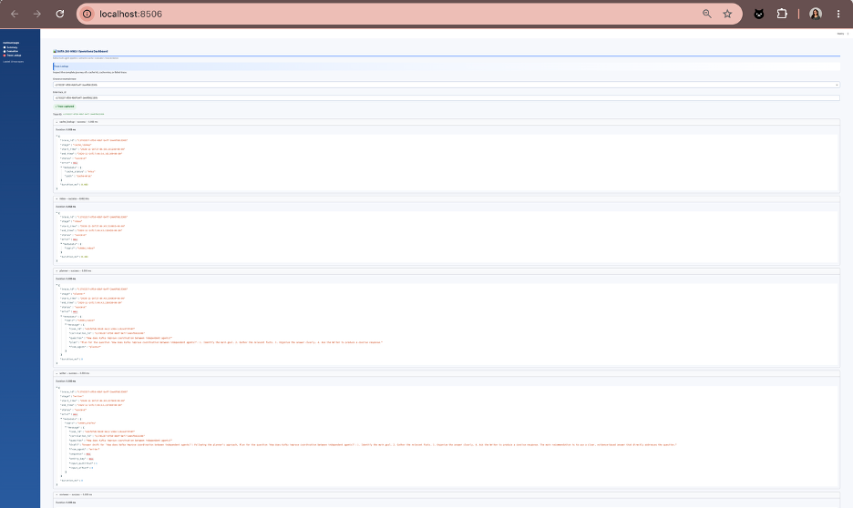

# DATA-260 Homework 10

Final PDF: [Shetty_HW10.pdf](https://github.com/shrustishetty-2401/data260-9004/blob/hw10/reports/hw10/Shetty_HW10.pdf)

## Student and Configuration

- Student: Shrusti Shetty
- SID4: 9004
- Prefix: `s9004`
- Branch: `hw10`
- Kafka bootstrap server: `localhost:29092`
- Local judge model: `qwen3:8b` through Ollama

## Overview

This homework extends the HW8 Kafka multi-agent pipeline with automated evaluation, human judge validation, distributed tracing, latency measurements, and a Streamlit operations dashboard.

The HW10 implementation evaluates the Planner, Writer, and Reviewer stages. It preserves the same `correlation_id` across pipeline messages, evaluates the generated plan and answers, records cache and pipeline traces, measures latency, and presents the results through a dashboard.

The implementation uses:

- Kafka and `aiokafka`
- Redis semantic-cache evidence from HW9
- DeepEval
- Ollama with the local `qwen3:8b` model
- Streamlit
- JSON and JSONL evidence files

## Part 1: Operations Dashboard

The operations dashboard is implemented in:

```text
code/hw10_dashboard.py
```

It is launched with:

```bash
streamlit run code/hw10_dashboard.py
```

The dashboard contains three pages.

### Judge Repeatability

Across the three repeated judge runs, zero of the 20 case scores changed. The mean absolute repeat change was 0.0 points, and the maximum absolute repeat change was 0.0 points. The judge was therefore repeatable under the documented settings, but its low Spearman correlation of 0.0421 means it should not gate deployment without additional human-labeled validation and expert review.

The dashboard uses Streamlit `@st.cache_data` to cache reusable JSON and JSONL evidence-loading operations.

### Summary Page

The Summary page displays:

- Number of captured traces
- Cache-hit count
- Cache-miss count
- Failed-span count
- Total latency p50 and p95
- Planner, Writer, Reviewer, and queue latency
- Dominant p95 latency contributor
- Confirmed cache-miss count
- Data source and experiment time window

The dashboard reads:

```text
reports/hw10/raw/traces.jsonl
reports/hw10/raw/latency_benchmark.json
reports/hw10/raw/pipeline_evaluation.json
reports/hw10/raw/judge_validation.json
reports/hw10/raw/trace_examples.json
```

The latency chart shows p95 latency for queue wait, Planner, Writer, Reviewer, and the total pipeline.

The Summary page reports the semantic-cache hit rate separately from cache misses. In the captured evidence, there was 1 cache hit and 2 cache misses, giving a cache-hit rate of 33.3%. The dashboard also reports the error rate and total end-to-end latency using the local HW10 experiment time window and JSON/JSONL evidence files.

### Evaluation Page

The Evaluation page displays:

- Plan Quality score
- Writer Helpfulness score
- Final Answer Helpfulness score
- Draft score
- Final-answer score
- Final-versus-draft interpretation
- Spearman correlation from judge validation
- Mean absolute difference from human labels
- Repeated judge-validation results

The tested final response did not improve over the draft. Both the draft and final answer received a judge score of 1.0 because the generated answer was generic and did not explain Kafka coordination mechanisms.

The Evaluation page also displays the per-case judge results for all 20 Writer cases, including case ID, human label, judge score, normalized score, question, and judge reason. This makes the case-level comparison directly inspectable in the dashboard.

### Trace Lookup Page

The Trace Lookup page allows a user to select a trace ID and inspect:

- Cache lookup
- Cache hit or miss status
- Inbox stage
- Planner stage
- Writer stage
- Reviewer stage
- Evaluation stage
- Start and end timestamps
- Success or failure status
- Error details
- Stage metadata

Each displayed trace span includes its calculated duration in milliseconds in addition to the trace ID, stage, start time, end time, status, error, and metadata. The spans are displayed in request order from cache lookup through evaluation.

## Part 2: Automated Pipeline Evaluation

The Kafka pipeline uses:

```text
s9004_inbox
s9004_tasks
s9004_drafts
s9004_final
```

The original HW8 components are:

```text
code/hw8_planner.py
code/hw8_writer.py
code/hw8_reviewer.py
code/hw8_send_question.py
```

The evaluation program is:

```text
code/hw10_pipeline_evaluator.py
```

The evaluator joins Planner, Writer, and Reviewer messages using the same `correlation_id`.

The evaluator preserves:

- `task_id`
- `correlation_id`
- Question text
- Planner output
- Writer draft
- Reviewer output
- Kafka topic information
- Partition and offset metadata when available

The evaluator uses the local Ollama model:

```text
qwen3:8b
```

The evaluation criteria are:

1. Plan Quality
2. Writer Helpfulness
3. Final Answer Helpfulness
4. Final-versus-Draft Improvement

Scores use a 1–5 scale.

### End-to-End Question

The tested question was:

> How does Kafka improve coordination between independent agents?

The trace ID was:

```text
f9c6814e-8ce7-4b4e-b537-5b08d76df0b2
```

The task ID was:

```text
7be2045f-e63d-4744-9591-f791a5b1b3d5
```

The pipeline completed successfully and produced an approved final result.

However, the generated answer was generic. It described a planning process instead of explaining Kafka's coordination mechanisms. The local judge therefore gave:

| Metric | Score |
|---|---:|
| Plan Quality | 1.0 |
| Writer Helpfulness | 1.0 |
| Final Answer Helpfulness | 1.0 |
| Draft score | 1.0 |
| Final score | 1.0 |
| Final improvement | 0.0 |

The final answer did not improve over the draft. This negative result is reported directly rather than being presented as a positive improvement.

Evidence:

```text
reports/hw10/raw/part2_planner.log
reports/hw10/raw/part2_writer.log
reports/hw10/raw/part2_reviewer.log
reports/hw10/raw/part2_sender.log
reports/hw10/raw/part2_evaluation.log
reports/hw10/raw/pipeline_evaluation.json
code/hw10_pipeline_evaluator.py
```

## Part 3: Human Judge Validation

The evaluation cases were generated with:

```text
code/hw10_prepare_eval_cases.py
```

The resulting dataset contains 20 Writer cases:

```text
reports/hw10/data/eval_cases.json
```

Human labels were recorded manually in:

```text
reports/hw10/data/human_labels.csv
```

The labels used a 1–5 helpfulness scale.

The final label distribution was:

| Human label | Count |
|---:|---:|
| 2 | 14 |
| 3 | 6 |
| Total | 20 |

The judge-validation program is:

```text
code/hw10_judge_validation.py
```

The judge was run on the same 20 cases using the local Ollama `qwen3:8b` model. Three repeated validation runs were performed.

The final repeated-validation result was:

```text
Spearman correlation: 0.0421
Mean absolute difference: 1.02
Case count: 20
```

The very low Spearman correlation indicates that the local judge did not strongly agree with the human helpfulness labels. The mean absolute difference of 1.02 shows noticeable disagreement between the judge and manual ratings.

This result means that the local judge should not be treated as a fully reliable replacement for human evaluation. It is useful as an automated diagnostic signal, but human review remains necessary for final quality decisions.

Evidence:

```text
reports/hw10/data/eval_cases.json
reports/hw10/data/human_labels.csv
reports/hw10/raw/judge_validation.json
reports/hw10/raw/judge_validation.log
code/hw10_prepare_eval_cases.py
code/hw10_judge_validation.py
```

## Part 4: Distributed Tracing

Tracing utilities are implemented in:

```text
code/hw10_trace_utils.py
code/hw10_trace_capture.py
```

Each trace span contains:

- `trace_id`
- Stage name
- Start timestamp
- End timestamp
- Status
- Error field when applicable
- Stage metadata

The trace ID is based on the same identifier used to correlate the Kafka pipeline.

The captured stages include:

```text
cache_lookup
inbox
planner
writer
reviewer
evaluation
```

The cache lookup span distinguishes:

```text
cache_status = hit
cache_status = miss
```

The trace output is stored in:

```text
reports/hw10/raw/traces.jsonl
reports/hw10/raw/trace_examples.json
reports/hw10/raw/trace_capture.log
```

### Cache-Hit Trace

```text
d6af01fe-3915-4e0b-9e1c-8d48f17b0c72
```

This trace records a semantic-cache hit.

### Failed Trace

```text
49241c44-b04f-4a1c-8ac5-84268d8babe9
```

This trace records a cache miss followed by a failed Planner stage. The failure evidence includes an error message describing the malformed request.

### Successful Cache-Miss Trace

```text
c1703237-df58-4bbf-bef7-2ee6fb61530b
```

This trace records a successful cache miss followed by the Kafka Planner, Writer, Reviewer, and evaluation stages.

The trace capture produced 10 spans across the required trace examples.

## Part 5: Latency Benchmark

The latency benchmark is implemented in:

```text
code/hw10_latency_benchmark.py
```

The benchmark generated 50 confirmed cache-miss requests. Every request passed through the Kafka pipeline.

The output files are:

```text
reports/hw10/raw/latency_benchmark.json
reports/hw10/raw/latency_benchmark.log
```


### Latency Results

| Stage | p50 (ms) | p95 (ms) | Percentage of cache-miss p95 |
|---|---:|---:|---:|
| Cache lookup | 0.00 | 0.00 | 0.00% |
| Queue wait | 1.00 | 1.60 | 23.34% |
| Planner | 1.46 | 2.08 | 30.40% |
| Writer | 1.27 | 1.97 | 28.79% |
| Reviewer | 1.23 | 1.91 | 27.81% |
| Evaluation | 0.01 | 0.01 | 0.22% |
| Total pipeline | 5.11 | 6.86 | 100.00% |

The benchmark recorded 50 confirmed cache misses. The Planner was the dominant p95 contributor at 30.40% of the total cache-miss latency. The first optimization target would therefore be the Planner stage.

Cache-hit behavior remains separate from the 50-request cache-miss benchmark.

## Conclusions

The HW10 implementation demonstrates how automated evaluation and distributed tracing can be added to a Kafka-based multi-agent pipeline.

Kafka preserved coordination between independent agents by carrying messages across separate topics while maintaining the same `correlation_id`. This allowed the evaluator to join Planner, Writer, and Reviewer outputs into one complete pipeline record.

The local judge successfully produced structured scores and explanations, but judge validation showed weak agreement with human labels:

```text
Spearman correlation: 0.0421
Mean absolute difference: 1.02
```

Therefore, the judge is useful for automated diagnostics but should not replace human review.

The tracing implementation distinguished cache hits, successful cache misses, and failed traces. The latency benchmark confirmed 50 cache misses and measured p50 and p95 latency for each major stage.

The Planner stage was the dominant p95 contributor at 30.40% of the total cache-miss p95 latency. This identifies the Planner stage as the first optimization target for future improvement.

## Reproducibility Evidence

```text
code/hw8_planner.py
code/hw8_writer.py
code/hw8_reviewer.py
code/hw8_send_question.py
code/hw10_dashboard.py
code/hw10_pipeline_evaluator.py
code/hw10_prepare_eval_cases.py
code/hw10_judge_validation.py
code/hw10_trace_utils.py
code/hw10_trace_capture.py
code/hw10_latency_benchmark.py
reports/hw10/data/eval_cases.json
reports/hw10/data/human_labels.csv
reports/hw10/raw/part2_planner.log
reports/hw10/raw/part2_writer.log
reports/hw10/raw/part2_reviewer.log
reports/hw10/raw/part2_sender.log
reports/hw10/raw/part2_evaluation.log
reports/hw10/raw/pipeline_evaluation.json
reports/hw10/raw/judge_validation.json
reports/hw10/raw/judge_validation.log
reports/hw10/raw/traces.jsonl
reports/hw10/raw/trace_examples.json
reports/hw10/raw/trace_capture.log
reports/hw10/raw/latency_benchmark.json
reports/hw10/raw/latency_benchmark.log
```

## AI Use

AI assistance was used to draft the HW10 evaluator, judge-validation logic, trace utilities, latency benchmark, dashboard, and report text.

The student ran the Kafka pipeline locally, configured the Ollama judge, created human labels, executed the three judge-validation repeats, captured successful and failed traces, ran the 50-request latency benchmark, inspected the dashboard, and reviewed the resulting evidence.

The local judge result was reported honestly. The final answer did not improve over the draft, and the low judge-human correlation was included as a limitation rather than hidden.

## Dashboard Evidence

### Figure 1. Operations Summary Dashboard



The Summary page reports trace count, cache hits and misses, failed spans, total p95 latency, stage latency, and the 50-request cache-miss benchmark.

The dashboard reports a semantic-cache hit rate of 33.3%, based on 1 cache hit and 2 cache misses. It also reports the error rate and total end-to-end latency for the local HW10 experiment window.

### Figure 2. Evaluation Dashboard



The Evaluation page reports Plan Quality, Writer Helpfulness, Final Answer Helpfulness, final-versus-draft comparison, and the three judge-validation repeats.

The Evaluation page displays per-case results for all 20 Writer cases, including the case ID, human label, judge score, normalized score, question, and judge reason.

### Figure 3. Cache-Hit Trace



The Trace Lookup page shows the cache-hit path and the `cache_status: "hit"` metadata.

### Figure 4. Successful Cache-Miss Trace



The Trace Lookup page shows the successful cache-miss path through the Kafka pipeline.

### Figure 5. Failed Trace



The Trace Lookup page shows the failed Planner stage and its recorded error.

Each trace span displays its calculated duration in milliseconds, along with the trace ID, stage, start time, end time, status, error, and metadata. Trace stages are displayed in request order.

## Final Git Verification

- Branch: `hw10`
- Final commit: `ac1853397b680c6463bc24f793f9d2cd2f7c98bd`
- Final tag: `hw10-final`
- Tagged commit: `ac1853397b680c6463bc24f793f9d2cd2f7c98bd`


## Submission Information

The final HW10 report target is:

```text
reports/hw10/Shetty_HW10.pdf
```
